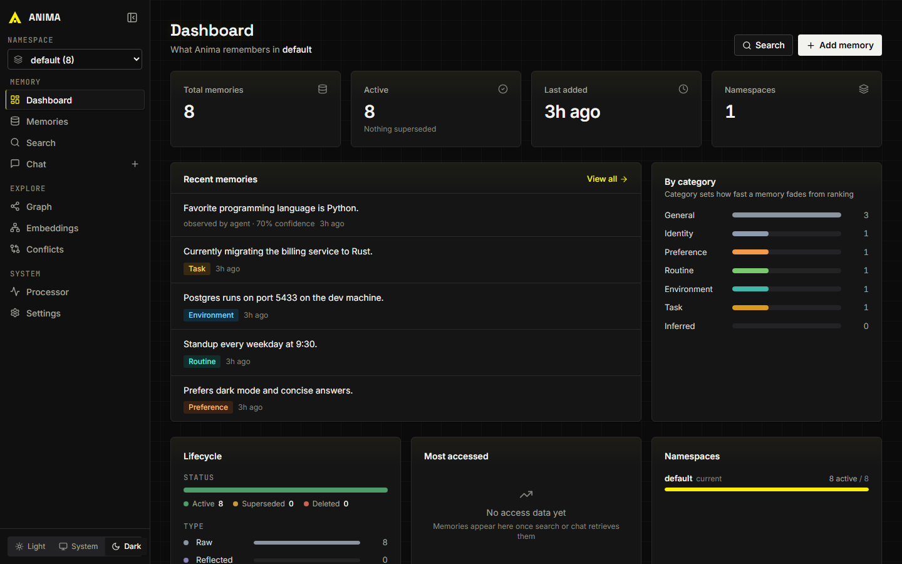
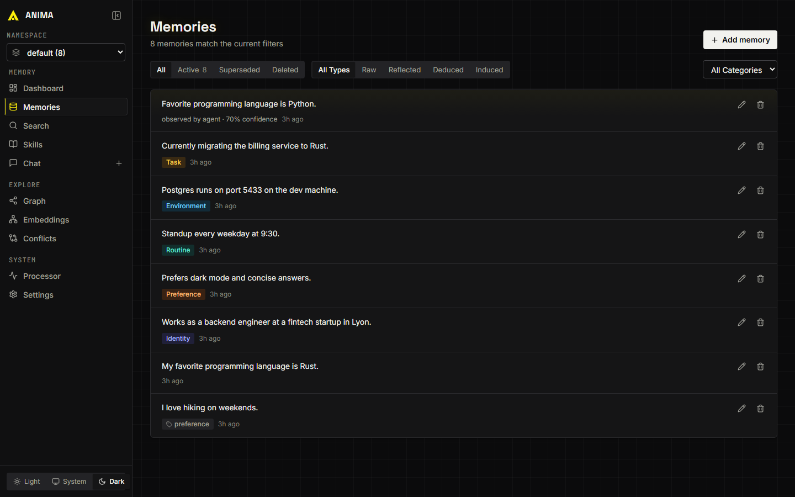
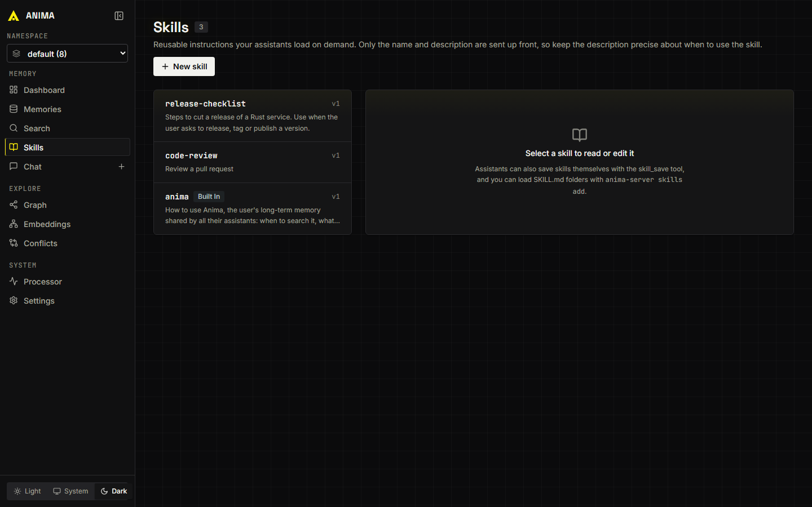

<p align="center">
  
</p>

# Anima

[License: Apache 2.0](LICENSE) · [Benchmarks](https://github.com/AnimaLab/Anima-Benchmarks) · [Contributing](CONTRIBUTING.md)

**Local-first memory for AI assistants and agents.** Anima remembers facts,
preferences, decisions, and prior context across sessions, in a single SQLite
file you control. No hosted backend required.

One Rust binary gives you a REST API, a web UI, an MCP server, hybrid retrieval
with local embeddings, and a full audit trail. One command connects it to
Claude Code, Codex, Cursor, Hermes and other harnesses, so every assistant you
use shares the same memory.

Your memories belong to you, not your LLM provider.



## Contents

- [Why Anima](#why-anima)
- [Quickstart](#quickstart)
- [LLM setup](#llm-setup)
- [Connect your tools](#connect-your-tools)
- [Briefing and skills](#briefing-and-skills)
- [Move to another machine](#move-to-another-machine)
- [Integrations](#integrations)
- [Concepts](#concepts)
- [Security](#security)
- [Deployment](#deployment)
- [Benchmarks](#benchmarks)
- [Development](#development)
- [Telemetry](#telemetry)

## Why Anima

- **Local-first**: memories live in a SQLite file on your machine. Embeddings
  and re-ranking run locally through ONNX.
- **Cloud-optional**: store and search need no LLM at all. Add Ollama or any
  OpenAI-compatible endpoint when you want generated answers and reflection.
- **Hybrid retrieval**: vector, keyword, and temporal signals are ranked
  together, with an optional cross-encoder re-ranker.
- **Auditable**: every memory has revisions, rollback, provenance, a
  confidence score, and a contradiction ledger showing what replaced what.
- **One memory for every assistant**: `anima-server connect` registers Anima
  with your harnesses, and `export` / `import` move it to a new machine in one
  file.
- **Easy to integrate**: REST API, MCP server, and web UI ship in this repo.

Anima is text-first today. Audio, image, and video ingestion are on the
roadmap, not shipped.

## Quickstart

### 1. Install

**Release binary** (no Rust needed). Download the archive for your platform
from [GitHub Releases](https://github.com/AnimaLab/Anima/releases), extract it,
and run `anima-server` from the extracted folder. Builds are published for
Linux (x86_64, aarch64), macOS (Apple Silicon), and Windows (x86_64). The
archive includes `config.default.toml` and service templates.

**Docker**. The container listens on all interfaces, so it requires an API key
(see [Security](#security)):

```bash
docker run -p 3000:3000 -e ANIMA_API_KEY=your-secret-key \
  -v ./anima.db:/app/anima.db ghcr.io/animalab/anima:latest
```

**From source**:

```bash
cargo build --release -p anima-server
./target/release/anima-server
```

Anima starts on `http://localhost:3000` and serves the web UI at the same
address. On first run it downloads the local models: the BGE-M3 embedder and
the bge-reranker-v2-m3 re-ranker (571 MB).

### 2. Store a memory

```bash
curl -X POST http://localhost:3000/api/v1/memories \
  -H "Content-Type: application/json" \
  -H "X-Anima-Namespace: default" \
  -d '{"content": "I love hiking on weekends.", "tags": ["preference"]}'
```

### 3. Search

```bash
curl -X POST http://localhost:3000/api/v1/memories/search \
  -H "Content-Type: application/json" \
  -H "X-Anima-Namespace: default" \
  -d '{"query": "What does the user like to do on weekends?", "limit": 5}'
```

### 4. Ask (needs an LLM backend)

```bash
curl -X POST http://localhost:3000/api/v1/ask \
  -H "Content-Type: application/json" \
  -H "X-Anima-Namespace: default" \
  -d '{"question": "What are the user'\''s hobbies?"}'
```

If the server has an API key, add `-H "Authorization: Bearer $ANIMA_API_KEY"`
to each request.

## LLM setup

Store and search work with zero configuration. `/ask`, `/chat`, and background
reflection need an LLM. By default Anima expects Ollama on the same machine:

```bash
ollama serve
ollama pull qwen3.5:4b
```

To use a cloud API (OpenAI, Groq, Together, or anything OpenAI-compatible),
copy `config.default.toml` to `config.toml` and edit:

```toml
[llm]
base_url = "https://api.groq.com/openai/v1"
model = "qwen/qwen3-32b"
api_key = ""  # or set OPENAI_API_KEY, also read from a .env file
```

If the LLM is unreachable, `/ask` degrades gracefully: it returns the retrieved
memories with `"degraded": true` instead of a generated answer.

### Provider profiles

Route each operation to a different model by defining named profiles:

```toml
[profiles.fast]
base_url = "http://localhost:11434/v1"
model = "qwen3.5:4b"

[profiles.cloud]
base_url = "https://api.groq.com/openai/v1"
model = "qwen/qwen3-32b"
api_key = ""  # or set CLOUD_API_KEY

[routing]
ask = "cloud"
chat = "fast"
processor = "cloud"
consolidation = "fast"
```

Profile names are arbitrary. Key resolution per profile is: config value, then
`{PROFILE_NAME}_API_KEY`, then `OPENAI_API_KEY`. Without `[profiles]`, the
`[llm]`, `[processor]`, and `[consolidation]` sections apply. A per-request
`llm` override on `/chat` and `/ask` always wins.

## Connect your tools

`connect` gives a harness access to your memory. It registers the MCP server,
adds a short instruction block telling the model when to read and write
memory, and, where the harness supports hooks, injects relevant memories
automatically.

```bash
anima-server connect claude          # Claude Code
anima-server connect codex           # Codex CLI
anima-server connect all             # every supported harness found on this machine
```

| Harness          | MCP server | Instructions            | Automatic recall |
| ---------------- | ---------- | ----------------------- | ---------------- |
| `claude`         | yes        | `CLAUDE.md` and skill   | hooks            |
| `claude-desktop` | yes        |                         |                  |
| `codex`          | yes        | `AGENTS.md` and skill   |                  |
| `cursor`         | yes        |                         |                  |
| `hermes`         | provider   | skill                   | memory provider  |

The skill is `anima`, a guide installed in the harness's own skills folder
that tells the model when to search memory, what to save and how to correct it.

On Hermes, Anima is installed as the external memory provider rather than as an
MCP server: Hermes then injects the briefing and the matching memories itself,
and mirrors what its built-in `memory` tool writes into Anima. If another
provider already holds that slot, `connect` leaves it alone and adds Anima as
an MCP server.

`anima-server connect print` prints the MCP entry and instructions for any
other MCP client.

Every edit is idempotent, keeps the rest of the file, and leaves a
`.before-anima` copy of the original. `disconnect <harness>` removes it again,
and `--dry-run` shows what would change. Restart the harness afterwards.

If the server is on another machine or needs a key, say so once:

```bash
anima-server connect all --url https://memory.example.org --api-key "$ANIMA_API_KEY"
```

The address and key are saved to `~/.anima/client.json`, not to the harness
files.

## Briefing and skills

At the start of a session a connected harness receives a briefing: who you
are, what is relevant to the current project, and which skills exist. It is
built without an LLM in a few milliseconds and held to a character budget, so
it stays small however much Anima remembers.

```text
About the user:
- Prefers dark mode and concise answers.
- My favorite programming language is Rust. (also on record, less trusted: "Favorite programming language is Python.")

Relevant to billing:
- Currently migrating the billing service to Rust.

Skills stored in Anima (load one with skill_get before using it):
- release-checklist: Steps to cut a release of a Rust service.
```

Memories about the same thing are collapsed to the most trusted one, and a
disagreement stays visible instead of being silently resolved. With each
message, the harness also receives the memories matching it that the briefing
did not already include.

Skills are reusable instructions: checklists, procedures, house style. Only
their names and descriptions go into the briefing; the body is loaded on
demand, so many skills cost little context. Existing `SKILL.md` folders load as
they are:

```bash
anima-server skills add ~/.claude/skills
anima-server skills list
```

Details are in [docs/concepts/briefing-and-skills.mdx](docs/concepts/briefing-and-skills.mdx).

## Move to another machine

```bash
anima-server export memories.json    # on the old machine
anima-server import memories.json    # on the new one
anima-server connect all
```

The export is plain JSON holding every namespace and every skill, with original
IDs, dates, categories and confidence. It carries no embeddings, so it does not depend on
the embedding model: the receiving server re-embeds on import. Importing twice
is safe; memories already present are skipped, and deleted ones stay deleted.

`export --full` takes a SQLite snapshot instead, which also carries
conversations, plans and revision history. Restoring one replaces the whole
database and needs `import --replace`.

## Integrations

### MCP

`anima-server mcp` serves the tools over MCP stdio; `connect` sets it up for
you. To configure a client by hand, run `anima-server connect print`.

A standalone TypeScript bridge with the same tools lives in `mcp/`, for
setups without the server binary on the client machine:

```bash
cd mcp && npm install && npm run build
```

Then add it to your MCP config:

```json
{
  "mcpServers": {
    "anima": {
      "command": "node",
      "args": ["path/to/mcp/dist/index.js"],
      "env": {
        "ANIMA_BASE_URL": "http://localhost:3000",
        "ANIMA_NAMESPACE": "default",
        "ANIMA_API_KEY": "only-if-the-server-requires-one"
      }
    }
  }
}
```

Tools: `memory_search`, `memory_add`, `memory_update`, `memory_delete`,
`memory_list`, `memory_stats`, `memory_ask`, `memory_reflect`,
`memory_discover`, `memory_briefing`, `skill_list`, `skill_get`, `skill_save`,
and `skill_delete`.

### Web UI

Open `http://localhost:3000` to browse and edit memories and skills, run searches, chat,
explore the memory graph, inspect conflicts and embeddings, and change
settings. Light and dark themes are included.

| Memories | Skills |
| -------- | ------ |
|  |  |

### REST API

Every `/api/v1/` request takes an `X-Anima-Namespace` header. The full
reference is in [docs/api-reference](docs/api-reference). Key routes:

| Route                                 | Description                                              |
| ------------------------------------- | -------------------------------------------------------- |
| `POST /api/v1/memories`               | Add a memory                                             |
| `GET /api/v1/memories`                | List memories, with `category` filter and cursor paging  |
| `POST /api/v1/memories/search`        | Hybrid search                                            |
| `POST /api/v1/memories/discover`      | Find memories similar to positive and negative examples  |
| `GET /api/v1/memories/{id}/revisions` | Revision history                                         |
| `GET /api/v1/memories/{id}/history`   | Supersession chain for a memory                          |
| `POST /api/v1/ask`                    | Retrieval-augmented answer, with `conflicts`             |
| `POST /api/v1/chat`                   | Conversational interface                                 |
| `GET /api/v1/contradictions`          | Contradiction ledger                                     |
| `POST /api/v1/briefing`               | Budgeted briefing for a session or a prompt              |
| `GET /api/v1/skills`, `/skills/{name}`| List, read, save and delete skills                       |
| `GET /api/v1/audit/events`            | Audit trail                                              |
| `GET /api/v1/profiles`                | Resolved LLM profiles and routing                        |
| `GET /api/v1/calibration/weights`     | Current auto-tuned search weights                        |
| `GET /api/v1/processor/status`        | Background processor metrics                             |
| `GET /health`, `GET /health/ready`    | Liveness and readiness probes                            |

## Concepts

### Memory categories

Each memory has a `category` that sets how fast it decays in ranking. Set it on
ingestion, or let the reflection pipeline classify extracted facts.

| Category      | Half-life   | Use case                                          |
| ------------- | ----------- | ------------------------------------------------- |
| `identity`    | ~2,888 days | Who the user is, names, relationships             |
| `preference`  | ~289 days   | Likes, dislikes, communication style              |
| `routine`     | ~96 days    | Recurring tasks, schedules, habits                |
| `environment` | ~58 days    | Ports, paths, services, technical infrastructure  |
| `inferred`    | ~29 days    | Conclusions Anima drew, not confirmed by the user |
| `general`     | ~29 days    | Default for uncategorized memories                |
| `task`        | ~6 days     | Current work, temporary context                   |

Define your own in `config.toml`:

```toml
[categories.health]
half_life_days = 144
```

Unknown categories use the global decay rate.

### Confidence and source

Each memory carries a `confidence` score (0.0 to 1.0) and a `source`. Higher
confidence ranks higher at equal relevance.

| Source           | Default confidence | When used                             |
| ---------------- | ------------------ | ------------------------------------- |
| `user_stated`    | 1.0                | The user explicitly provided the fact |
| `promoted`       | 0.8                | Promoted from agent working memory    |
| `agent_observed` | 0.7                | The agent noticed it from behavior    |
| `reflected`      | 0.6 (calibrated)   | Extracted by the reflection pipeline  |
| `deduced`        | 0.5 (calibrated)   | Inferred by combining reflected facts |
| `inferred`       | 0.5                | General inference, not user-confirmed |

When one memory supersedes another, the change is recorded in the contradiction
ledger. `/ask` reports conflicts among the memories it retrieved in a
`conflicts` array, and the web UI has a Conflicts page for supersession chains.

### Retrieval

Search blends vector similarity, keyword match, and temporal decay, with
weights auto-tuned from observations. Beyond the default hybrid mode:

- **`search_mode: "ask_retrieval"`** runs the full `/ask` retrieval pipeline
  (keyword expansion, entity resolution, temporal supplement, episode
  expansion) and returns results without calling an answer LLM.
- **`query_rewrite: true`** extracts keywords and expands the query first.
- **`group_by`** deduplicates results by episode, category, or source.
- **`/memories/discover`** finds memories similar to example IDs, with optional
  negative examples and a query bias.
- **Named vectors** store several embeddings per memory (for example content
  and summary) and blend them at query time. See `[[vectors]]` in
  `config.default.toml`.

```bash
curl -X POST http://localhost:3000/api/v1/memories/search \
  -H "Content-Type: application/json" \
  -H "X-Anima-Namespace: default" \
  -d '{"query": "What does Zhen like to eat?", "search_mode": "ask_retrieval", "limit": 10}'
```

### Re-ranking

A cross-encoder
([bge-reranker-v2-m3](https://huggingface.co/BAAI/bge-reranker-v2-m3), INT8)
re-scores the top candidates, catching paraphrases that embedding similarity
misses. It is enabled by default. High-confidence queries skip it (about
55 ms); ambiguous ones use it (about 200 ms). Tune `top_n` under `[reranker]`
to trade latency for ordering quality, or set `enabled = false`.

### Embeddings

The default embedder is BGE-M3 (1024 dimensions) running locally through ONNX.
`config.default.toml` includes ready-made alternatives, including
Qwen3-Embedding-0.6B. To use a hosted embedding API instead:

```toml
[embedding]
backend = "openai_compat"
api_base_url = "https://api.cohere.com/compatibility/v1"
api_model = "embed-v4.0"
api_key = ""  # or set EMBEDDING_API_KEY
dimension = 1024
```

This works with OpenAI, Cohere, Voyage, Together, vLLM, or any provider with an
OpenAI-style `/embeddings` endpoint. Changing the model or dimension requires
re-embedding existing memories.

## Security

Anima's defaults assume a single trusted machine.

- **Loopback, no key (default)**: the server binds `127.0.0.1` and accepts
  unauthenticated requests, but only when the request `Host` is a loopback
  name. This blocks DNS-rebinding attacks from web pages in your browser.
- **API key**: set `ANIMA_API_KEY` (or `api_key` under `[server]`) and every
  `/api/*` request must send `Authorization: Bearer <key>` or
  `X-Anima-Api-Key`. `/health` and the static web UI stay public; the UI
  prompts for the key on first use.
- **Non-loopback binds require a key**: with `host = "0.0.0.0"` (Docker, LAN)
  the server refuses to start without one, unless you set
  `allow_unauthenticated = true` because a reverse proxy handles auth.
- **CORS is closed by default**: other origins cannot call the API from a
  browser. Allow specific ones with
  `cors_allowed_origins = ["https://app.example.com"]`.

Namespaces isolate data, and `ANIMA_NAMESPACE_ACL` can restrict which principal
reads or writes each namespace. The principal comes from the
`X-Anima-Principal` header, which the caller sets itself. Rely on namespace
ACLs only when every holder of the API key is trusted to identify itself
honestly, or when a gateway sets the header.

## Deployment

### Docker

```bash
docker build -t anima-server .
docker run -p 3000:3000 -e ANIMA_API_KEY=your-secret-key \
  -v ./anima.db:/app/anima.db anima-server
```

The image binds `0.0.0.0:3000` and points the default Ollama URLs at
`host.docker.internal`.

### System service

```bash
anima-server --install          # auto-detects the platform
anima-server --service-status
anima-server --uninstall
```

| Platform | Backend | Details                                                                   |
| -------- | ------- | ------------------------------------------------------------------------- |
| Linux    | systemd | Unit at `/etc/systemd/system/anima-server.service`, logs via `journalctl` |
| macOS    | launchd | Plist at `~/Library/LaunchAgents/dev.anima.server.plist`, starts on login |
| Windows  | Task Scheduler | Per-user task "Anima Server", starts on logon, no administrator rights; logs in `anima-server.log` |

Run `--install` from the directory that holds your `config.toml` and
`anima.db`: the service uses the current working directory and binary path.
Templates for manual setup are in [service/](service).

## Benchmarks

On [LoCoMo](https://github.com/snap-research/locomo), the academic benchmark
for long-term conversational memory:

| Run                                             | Accuracy  | Answer model  | Judge model   |
| ----------------------------------------------- | --------- | ------------- | ------------- |
| Full dataset, 10 conversations, 1,540 questions | **87.7%** | Qwen3.5-27B   | Qwen3.5-27B   |
| Full dataset, curated report run                | 86.0%     | qwen3-32b     | llama-3.3-70b |
| `conv-26` only, 152 questions                   | 93.4%     | llama-3.3-70b | qwen3-32b     |

Read these with care. LoCoMo scores move by many points with the answer and
judge models, so numbers from different systems are only comparable when run
under the same setup. The single-conversation figure comes from the
conversation used during development and should not be read as a full-dataset
result. Temporal questions are the weakest category (54% in the best full run).

Per-category results and run history are in
[benchmarks/locomo](benchmarks/locomo); methodology is in
[Anima-Benchmarks](https://github.com/AnimaLab/Anima-Benchmarks). A
LongMemEval harness is included in
[benchmarks/longmemeval](benchmarks/longmemeval), with no published score yet.
See [DATASETS.md](DATASETS.md) for dataset sources.

## Development

```bash
cargo test --workspace                 # Rust
cd web && npm install && npm run build # web UI
cd mcp && npm install && npm run build # MCP bridge
```

Repository layout:

- [crates/](crates): Rust workspace (core types, database, embeddings,
  consolidation, server)
- [web/](web): React web UI
- [mcp/](mcp): TypeScript MCP server
- [docs/](docs): documentation site sources
- [benchmarks/](benchmarks): benchmark harnesses and results
- [scripts/](scripts), [service/](service): local startup helpers and service
  templates

See [CONTRIBUTING.md](CONTRIBUTING.md) for setup and pull request expectations.

## Telemetry

Anima sends anonymous usage analytics once a day: model names, memory counts,
OS and architecture, and feature flags. It never sends memory content,
namespace names, or API keys.

Telemetry is **on by default**. To turn it off, set this in `config.toml`:

```toml
[telemetry]
enabled = false
```

The Settings page in the web UI can also switch it off, but only until the
next restart.

## License

Apache License 2.0. See [LICENSE](LICENSE).
